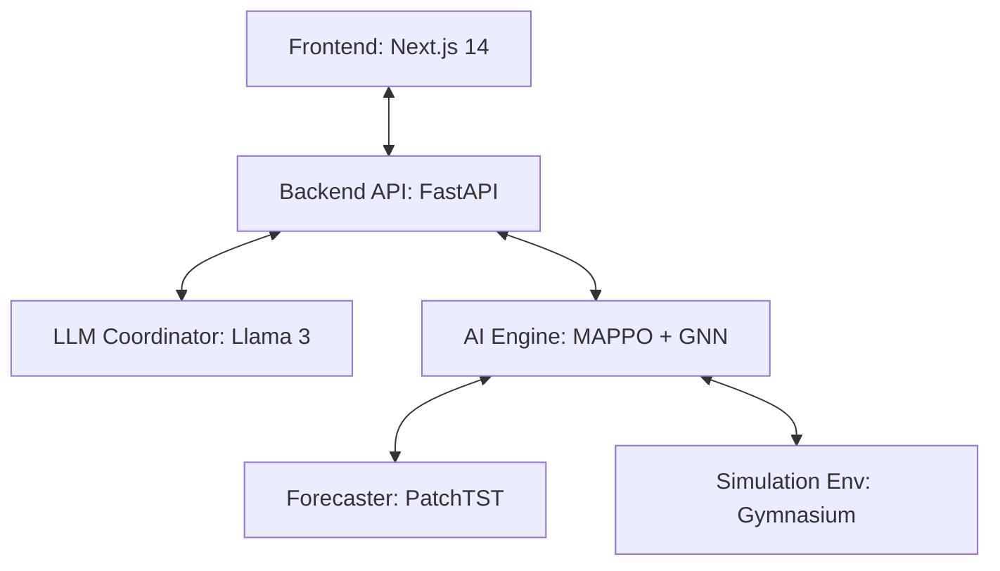

<div align="center">
  
  
  
  
  
  
  <br />
  <br />

  <h1>🌍 SupplyMind</h1>
  <p><b>Intelligent Multi-Agent Reinforcement Learning for Resilient Supply Chain Optimization</b></p>
</div>

---

**SupplyMind** is a state-of-the-art SaaS platform designed to optimize multi-echelon supply chain inventory management under deep uncertainty. Originally built as a Master's Thesis Project, it replaces brittle heuristic policies (like Base-Stock or `(s,S)`) with an advanced **Multi-Agent Reinforcement Learning (MARL)** architecture, integrated with **Graph Neural Networks (GNN)**, **Transformers (PatchTST)**, and **Large Language Models (Llama 3)**.

## ✨ Key Features

- 🤖 **Multi-Agent Reinforcement Learning (MAPPO)**: Autonomous agents (Retailers, Distributors, Suppliers) learn cooperative ordering policies to minimize total chain cost while aggressively avoiding stockouts.
- 🕸️ **Graph Neural Network (GNN) Communication**: Agents share hidden state representations through the supply chain topology, naturally preventing the notorious **Bullwhip Effect**.
- 🔮 **Proactive Transformer Forecasting**: Integrated **PatchTST** models analyze historical data to inject 7-day rolling forecasts directly into the agents' observation space.
- ⚡ **Live Control Engine**: Connect your live PostgreSQL/MySQL database to the platform to receive real-time, explainable AI ordering recommendations.
- 🌪️ **Disruption Simulation**: Simulate extreme what-if scenarios (massive demand spikes, sudden lead time delays, node failures) and observe how the MARL policy outperforms classical heuristics by over **85%** in financial resilience.
- 🧠 **LLM Coordinator**: An integrated Llama 3.3 agent (via Groq) acts as a human-readable supervisor, explaining agent behavior, summarizing vulnerabilities, and outputting narrative analysis.

## 🏗️ System Architecture

The core RL engine utilizes a **CTDE (Centralized Training, Decentralized Execution)** paradigm.



## 🚀 Getting Started

### 1. Backend API (FastAPI)

Ensure you have **Python 3.12+** installed.

```bash
# Navigate to backend
cd supplyMind/backend

# Create and activate virtual environment
python -m venv .venv
source .venv/bin/activate  # On Windows use: .venv\Scripts\activate

# Install dependencies
pip install -r requirements.txt
```

**Environment Setup:**
Create a `.env` file in `supplyMind/backend` based on the example:
```env
JWT_SECRET=your_super_secret_key
GROQ_API_KEY=your_groq_api_key_here
```

**Run the Server:**
```bash
uvicorn main:app --reload --port 8000
```

### 2. Frontend Dashboard (Next.js)

Ensure you have **Node.js 18+** installed.

```bash
# Navigate to frontend
cd supplyMind/frontend

# Install dependencies
npm install

# Start development server
npm run dev
```
The platform will now be accessible at `http://localhost:3000`.

## 📈 Academic Validation

Under normal conditions, the MAPPO+GNN architecture performs comparably to heavily-optimized `(s,S)` policies. However, under **severe supply chain disruptions** (e.g., global shipping delays, panic buying), classical heuristics collapse. The MAPPO+GNN agent degrades gracefully, reducing the financial impact of disruptions by up to **85%** compared to traditional baselines.

---
<div align="center">
  <i>Developed with ❤️ by Abdelaaziz Afquir</i>
</div>
